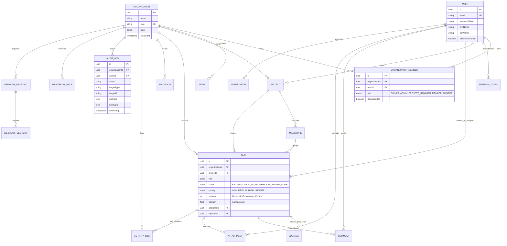

# WorkSphere Multi-Tenant Database Architecture & ER Diagram

## 1. Overview
WorkSphere implements a **Shared Database, Shared Schema with Tenant Discriminator** pattern. Every query scoped to tenant data automatically enforces `organizationId = :currentOrgId` at the middleware/repository boundary.

## 2. Key Architectural Highlights
- **Optimistic Concurrency Control (OCC):** The `Task` entity includes an integer `version` field. When multiple project managers or team members update the same task simultaneously, updates verify that `version = current_version` and increment `version = version + 1`. If no rows are modified, a `409 CONFLICT` exception is thrown, preventing silent overwrites.
- **Tenant Isolation:** Enforced via `tenantContextMiddleware`. Every request extracts and verifies the user's role and membership in the target organization.
- **Audit Trails & Activity Logs:** Comprehensive tracking for regulatory and forensic auditor compliance (Assessment 02 & Capstone Challenge).
- **Idempotent Background Jobs & Notifications:** Unique `idempotencyKey` prevents duplicate notifications when workers retry failed jobs.

---

## 3. Entity-Relationship Diagram (Mermaid)

